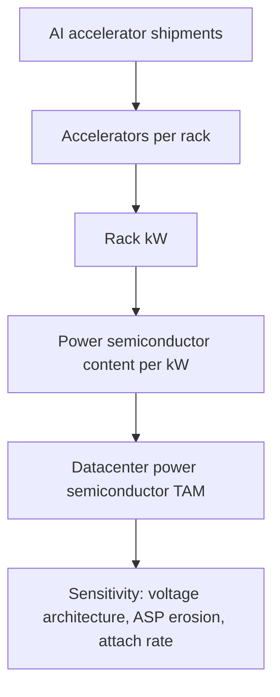
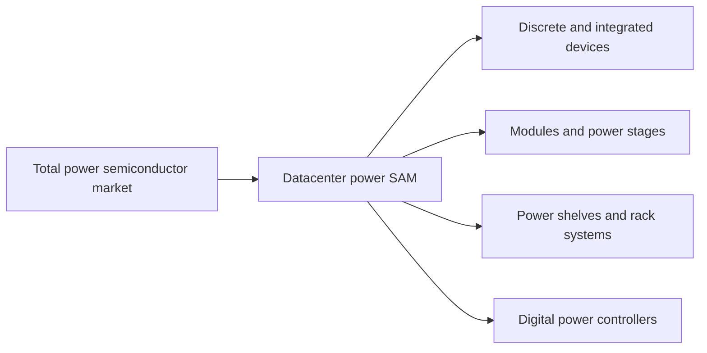

# Market Sizing
> **Last Updated:** 2026-07-28
> **Status:** Draft
> **Tags:** TAM, forecast, scenarios, content-per-kW

## Overview
Market size is modeled from rack shipments, power per rack, semiconductor content per kW, and
WBG/controller penetration. Published research often mixes power supplies, modules, power ICs,
and facility equipment, so top-down numbers are not directly comparable.

The baseline below is an analyst framework, not a purchased market-research dataset. Values are
[ESTIMATED] and should be replaced with auditable bottom-up inputs before investment use.

## Key Findings / Highlights
- [ESTIMATED, MED confidence] Total DC power semiconductors reach roughly $4B around 2026 under this database boundary.
- [ESTIMATED, MED] VRM/PMIC/control is the largest semiconductor pool; rack systems are tracked separately.
- [ESTIMATED, HIGH] Content per rack rises faster than rack count as accelerator TDP and conversion stages rise.
- [ESTIMATED, MED] WBG ASP premiums fall while penetration rises, making revenue impact non-linear.
- [TO VERIFY] $12k-$15k semiconductor content for a 130 kW rack requires primary-source confirmation.
- [CONFIRMED, 2026] Infineon's AI power-solution category exceeded €700M in FY2025 and is
  targeted at ~€1.5B in FY2026 and ~€2.5B in FY2027; this category is broader than the
  database's device-only boundary and is a useful upper-bound cross-check, not a share figure.
- [CONFIRMED, 2025] onsemi disclosed >$250M AI-datacenter revenue; MPS disclosed $732.5M
  storage/computing and $701.8M enterprise-data revenue, neither of which is a clean
  datacenter-power-semiconductor measure.

## Visual Guide

## Detailed Content
### Segment Forecast

| Segment | 2024A $B | 2025E | 2026E | 2028E | 2030E | CAGR 24-30 | Confidence |
|---|---:|---:|---:|---:|---:|---:|---|
| Total DC power semiconductors | 3.0 | 3.5 | 4.0 | 5.5 | 7.2 | ~16% | MED |
| GaN devices/ICs for DC | 0.15 | 0.23 | 0.34 | 0.75 | 1.25 | ~42% | LOW-MED |
| SiC devices for DC | 0.12 | 0.18 | 0.26 | 0.60 | 1.00 | ~42% | LOW |
| Silicon power discretes | 0.85 | 0.93 | 1.02 | 1.25 | 1.45 | ~9% | MED |
| VRM/PMIC/controllers | 1.35 | 1.55 | 1.75 | 2.30 | 2.85 | ~13% | MED |
| Gate drivers/sensing | 0.28 | 0.32 | 0.37 | 0.50 | 0.65 | ~15% | LOW-MED |
| Power modules (semiconductor value) | 0.25 | 0.29 | 0.34 | 0.50 | 0.70 | ~19% | LOW |

> ⚠️ Note: Rows overlap if controller/driver content is embedded in GaN ICs or modules.
Do not sum subsegments without applying overlap adjustments.

### Content per Rack

| Rack type | kW | Semiconductor content | $/kW | Status/source |
|---|---:|---:|---:|---|
| Legacy server | 12 | $500-1,200 | $42-100 | [ESTIMATED, LOW] |
| AI rack | 30 | $2,000-4,000 | $67-133 | [ESTIMATED, LOW] |
| High-density AI | 80 | $6,000-10,000 | $75-125 | [ESTIMATED, LOW] |
| Future rack | 130 | $12,000-15,000 | $92-115 | [TO VERIFY Infineon claim] |

### Scenarios

| Scenario | 2025 $B | 2027 $B | 2030 $B | Assumption |
|---|---:|---:|---:|---|
| Bear | 3.3 | 4.0 | 5.2 | Slower AI builds, ASP compression |
| Base | 3.5 | 4.7 | 7.2 | Strong AI and gradual WBG |
| Bull | 3.7 | 5.5 | 9.5 | 200 kW racks and rapid WBG/HVDC |

### Driver Equation

Semiconductor revenue = AI rack shipments x average rack kW x semiconductor dollars/kW,
adjusted for non-AI servers, replacement, ASP erosion, custom silicon, and channel inventory.
See [25_investment_and_ma_tracker.md](25_investment_and_ma_tracker.md).

### Public-Disclosure Cross-Checks

| Company | Period | Disclosure | Boundary caveat |
|---|---|---:|---|
| Infineon | FY2025 actual | >€700M AI power solutions | Vendor-defined grid-to-core category |
| Infineon | FY2026/FY2027 target | ~€1.5B / ~€2.5B | Forward-looking company target |
| onsemi | FY2025 actual | >$250M AI-datacenter revenue | Company category; product mix not fully disclosed |
| MPS | FY2025 actual | $732.5M storage/computing + $701.8M enterprise data | Includes memory, storage, notebook, graphics, and other non-AI content |

> ⚠️ Note: These disclosures cannot be summed or directly compared with the $4.0B model.
They demonstrate why the TAM boundary must state whether it includes controllers, modules,
sensing, protection, and non-semiconductor power content.

## Data Tables (where applicable)
| Field | Value | Source | Date |
|---|---|---|---|
| Base TAM | [ESTIMATED] $4.0B | Analyst model | 2026E |
| Base 2030 TAM | [ESTIMATED] $7.2B | Analyst model | 2030E |
| Base CAGR | ~16% | Calculation | 2024-2030 |
| Bull 2030 | [ESTIMATED] $9.5B | Scenario model | 2030E |
| Bear 2030 | [ESTIMATED] $5.2B | Scenario model | 2030E |

## Open Questions / Gaps
- Build a shipment model by hyperscaler, accelerator generation, rack type, and geography.
- License/obtain comparable Omdia, Yole, TechInsights, and company datasets.
- Eliminate overlap between integrated GaN ICs, drivers, controllers, and modules.
- Validate content-per-kW through teardowns and supplier revenue bridges.

## References
- Yole Group power electronics | https://www.yolegroup.com/ | Accessed 2026-06-10
- Omdia datacenter research | https://omdia.tech.informa.com/ | Accessed 2026-06-10
- TechInsights power semiconductor analysis | https://www.techinsights.com/ | Accessed 2026-06-10
- Company investor-day disclosures | respective IR sites | Accessed 2026-06-10
- Infineon FY2026 AGM CEO speech | https://www.infineon.com/assets/row/public/documents/corporate/investors/annual-general-meeting/2026/agm2026-key-points-speech-jochen-hanebeck-chief-executive-officer-v01-00-en.pdf | Accessed 2026-07-28
- onsemi 2025 annual report | https://investor.onsemi.com/static-files/8d674d4f-cc6b-44e5-8e31-e898ab0b4371 | Accessed 2026-07-28
- MPS 2025 Form 10-K | https://media.monolithicpower.com/mps_cms_document/2/0/2025_form_10-k_final.pdf | Accessed 2026-07-28
