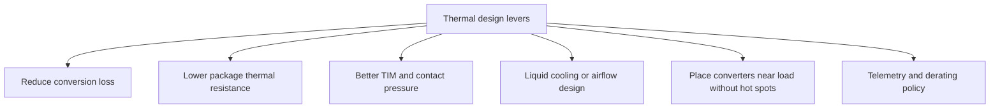

# Thermal Management
> **Last Updated:** 2026-11-12
> **Status:** Draft
> **Tags:** thermal, cooling, TIM, liquid-cooling, simulation

## Overview
Semiconductor loss becomes junction temperature through a series thermal-resistance network.
Higher switching density can shrink electrical components while making heat flux and interface
quality harder to manage.

AI racks increasingly use direct liquid cooling for processors; power shelves, VRMs, connectors,
and busbars also require co-design. Material thermal conductivity alone does not determine
device temperature because die thickness, package, TIM, contact pressure, and coolant dominate.

## Key Findings / Highlights
- [CONFIRMED] Tj = Ta + Ploss x total thermal resistance is the basic steady-state model.
- [CONFIRMED] SiC bulk thermal conductivity is roughly 2-3x silicon, grade/temperature dependent.
- [CONFIRMED] Many commercial Si/GaN devices are rated near 150 C; SiC often 175 C or higher.
- [ESTIMATED] Air cooling becomes difficult for concentrated ~30 W+ package dissipation without large airflow/heatsinks.
- [CONFIRMED] Double-sided and direct-substrate cooling reduce package thermal bottlenecks.
- [CONFIRMED, 2026-10] Liquid cooling is reaching the power path: OCP Global Summit 2026 included
  a Megmeet/NVIDIA liquid-cooled power-shelf session, Delta showed an 800 VDC liquid-to-liquid
  CDU (2.5 MW in the OCP release; 3.6 MW in a pre-show release, an unresolved discrepancy), and
  Supermicro ships Vera Rubin NVL72 racks with 1.8 MW in-row CDUs.
- [RUMORED, 2026-10] Trade reports describe a liquid-cooled 5,000 A rack busbar and fanless,
  liquid-cooled compute trays in NVIDIA MGX 1.2; confirm against the specification text.

## Visual Guide

## Detailed Content
### Thermal Chain

| Layer | Typical Rth | Materials | Innovation |
|---|---:|---|---|
| Junction-to-case | 0.05-5 C/W | die attach, copper clip, mold | double-sided cooling |
| Case-to-heatsink | 0.05-1 C/W | TIM, pressure interface | phase-change/graphite |
| Heatsink-to-fluid | 0.01-1+ C/W | Al/Cu cold plate/fins | microchannels |
| PCB spreading | design-specific | copper planes/vias | embedded copper/substrates |

### Junction Limits

| Technology | Common rated Tj max | Caveat |
|---|---:|---|
| Silicon MOSFET/IC | 125-175 C | Product-specific |
| SiC MOSFET | 175-200 C class | Package may limit |
| GaN power device | 150-175 C common | Layer temperature can differ from case model |

### Rack Cooling

| Method | Power-density fit | Power-component implication |
|---|---|---|
| Forced air | low-medium | Large sinks, airflow pressure |
| Rear-door heat exchanger | medium-high | Air-cooled electronics retained |
| Direct liquid cold plate | high | Leak/material/service design |
| Immersion | high | Fluid compatibility and certification |
| Embedded microfluidics | future/extreme | Manufacturing/reliability challenge |
| Liquid-cooled power shelf/busbar | 2026 emerging (OCP/MGX ecosystem) | Coolant-adjacent HV insulation, condensation, and serviceability |

### TIMs

| Type | Conductivity | Application | Vendors/examples |
|---|---:|---|---|
| Thermal grease/gel | ~1-10 W/mK | serviceable interfaces | Henkel, Dow, Shin-Etsu |
| Phase-change | ~1-8 W/mK | controlled bond line | Honeywell, Henkel |
| Graphite pad | anisotropic, high in-plane | spreading | Panasonic, NeoGraf |
| Gap pad | ~1-15 W/mK | tolerance filling | Bergquist/Henkel, Laird |
| Indium/liquid metal | high | premium interfaces | Indium Corp.; compatibility limits |

### Tools

ANSYS Icepak, Siemens FloTHERM, and Future Facilities 6SigmaET support electronics/rack thermal
simulation. Electrical-thermal co-simulation is required when RDS(on), switching loss, and
control mode change with temperature.

Related: [Master Index](README.md).

## Data Tables (where applicable)
| Field | Value | Source | Date |
|---|---|---|---|
| Silicon k | ~150 W/mK | Materials references | 2025 |
| 4H-SiC k | ~370-490 W/mK | Materials references | 2025 |
| Common SiC Tj max | 175-200 C class | Datasheets | 2025 |
| Common GaN Tj max | 150-175 C | Datasheets | 2025 |
| AI rack cooling trend | Direct liquid expanding | OEM platforms | 2025-2026 |
| Supermicro Vera Rubin CDU | 1.8 MW in-row, N+1 | Supermicro | 2026-09-23 |
| Delta 800 VDC L2L CDU | Up to 2.5 MW (OCP release) | Delta | 2026-10-15 |

## Open Questions / Gaps
- Add transient thermal impedance curves for representative devices/modules.
- Collect rack power-shelf liquid-cooling products and field deployments (2026 OCP sessions
  provide the first product-level candidates).
- Test immersion-fluid compatibility with encapsulants, TIMs, connectors, and capacitors.
- Build thermal cost per kW comparison.

## References
- ANSYS Icepak | https://www.ansys.com/products/electronics/ansys-icepak | Accessed 2026-06-10
- Siemens FloTHERM | https://plm.sw.siemens.com/en-US/simcenter/fluids-thermal-simulation/flotherm/ | Accessed 2026-06-10
- 6SigmaET | https://www.6sigmaet.info/ | Accessed 2026-06-10
- OCP Global Summit 2026 recorded content | https://www.opencompute.org/events/ocp-summit/2026-ocp-global-summit/recorded-content/ | Indexed 2026-11-12
- Delta OCP 2026 announcements | https://www.prnewswire.com/news-releases/delta-highlights-collaboration-with-nvidia-in-advancing-energy-efficient-800-vdc-power-and-cooling-solutions-for-ai-data-centers-at-ocp-global-summit-2026-302909912.html | Indexed 2026-11-12
- Supermicro Vera Rubin NVL72 shipping | https://ir.supermicro.com/news/news-details/2026/Supermicro-Now-Shipping-NVIDIA-Vera-Rubin-NVL72-Racks/default.aspx | Indexed 2026-11-12
