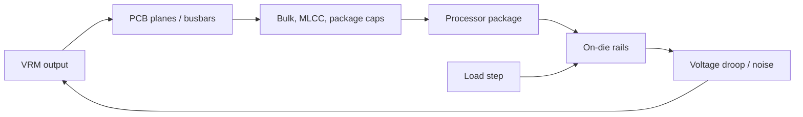
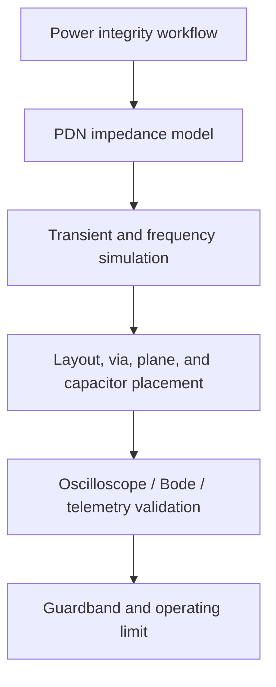

# Power Integrity and Signal
> **Last Updated:** 2026-11-12
> **Status:** Draft
> **Tags:** power-integrity, PDN, transient, capacitor, magnetics

## Overview
Power integrity ensures processor voltage remains inside its tolerance window during steady and
transient operation. The target impedance method converts allowed droop and load step into a
frequency-dependent PDN requirement.

At kiloampere-class rails, milliohms and nanohenries matter. Package, PCB planes, vias,
connectors, cables, capacitors, inductors, and control loops must be modeled together.

## Key Findings / Highlights
- [CONFIRMED] Target impedance Ztarget = allowed voltage deviation / load-current step.
- [CONFIRMED] 1 nH produces 1 V at a 1 A/ns current slew.
- [CONFIRMED] MLCC capacitance falls with DC bias, especially high-capacitance class-II dielectrics.
- [CONFIRMED] Interleaved/coupled inductors can improve ripple and transient performance.
- [ESTIMATED] Public GPU TDP is insufficient to determine actual rail di/dt or droop budget.
- [CONFIRMED, 2026-10] New node architectures feed 12 V or 6 V intermediate rails directly from
  800 VDC (Navitas/NVIDIA, Infineon/NVIDIA, TI, Microchip/Navitas), shifting PDN design toward
  lower-voltage, higher-current board distribution that must be co-designed with the PI budget.
- [CONFIRMED, 2026] Integrated and vertical voltage regulation became an M&A focus: ADI/Empower
  (closed 2026-07-07), Navitas/Claros (closed 2026-10-06), Infineon/C2i (closed ~2026-10), and
  onsemi/Ferric (announced 2026-11-02). Vicor's ITC complaint (337-TA-1526) targets vertical
  power-delivery supply chains.

## Visual Guide

## Detailed Content
### Accelerator PI Snapshot

| Platform | Public power | VCC | Max rail current | di/dt | Connector/path |
|---|---:|---:|---:|---:|---|
| H100 SXM | up to 700 W | [TO VERIFY] | [TO VERIFY] | [TO VERIFY] | SXM/baseboard |
| H200 SXM | 700 W class | [TO VERIFY] | [TO VERIFY] | [TO VERIFY] | SXM/baseboard |
| B200 SXM | up to ~1,000 W | [TO VERIFY] | [TO VERIFY] | [TO VERIFY] | SXM/baseboard |
| GB200 NVL72 | rack-scale | multiple rails | [TO VERIFY] | [TO VERIFY] | 48 V rack ecosystem |
| Vera Rubin NVL72 | ~190-230 kW rack [ESTIMATED, MED]; GPU ~1.8-2.3 kW [ESTIMATED] | multiple rails | [TO VERIFY] | [TO VERIFY] | 54 V in rack; 800 VDC sidecar option |

### PDN Elements

| Element | Dominant parasitic | Mitigation |
|---|---|---|
| VRM | control output impedance | bandwidth/feed-forward |
| Bulk capacitor | ESR/ESL | technology mix and placement |
| MLCC | DC-bias capacitance/ESL | derating and close placement |
| PCB plane/via | spreading/via inductance | wide planes, via arrays |
| Package/RDL | resistance/inductance | vertical delivery, dense bumps |
| Connector/cable | resistance/loop inductance | 48 V distribution, busbars |
| 800 V-to-12/6 V node converter | transformer leakage, output ripple at 6-12 V | high-ratio resonant stage near load |
| Integrated/vertical VR | package/substrate parasitics | IVR, substrate-integrated regulators, vertical delivery |

### Measurement and Simulation

- VNA impedance measurement with appropriate fixtures and calibration.
- Oscilloscope load-step response using low-inductance probing.
- TDR for interconnect discontinuities.
- Cadence Sigrity, Ansys SIwave, and Siemens HyperLynx PI for extraction/simulation.

### Capacitors

| Supplier | Strength | Relevance |
|---|---|---|
| Murata | MLCC/polymer ecosystem | Board decoupling |
| TDK | MLCC/film/electrolytic | Board and rack |
| Samsung Electro-Mechanics | High-volume MLCC | Board |
| Yageo/KEMET | MLCC/polymer/film | Broad |

### Magnetics

Ferrite offers low high-frequency core loss; powdered iron/composite materials support high
saturation/current; nanocrystalline materials suit high-frequency common-mode and larger
magnetics. Key suppliers include Vishay, Bourns, Coilcraft, TDK, Wuerth, and Cyntec.

Related: [Master Index](README.md).

## Data Tables (where applicable)
| Field | Value | Source | Date |
|---|---|---|---|
| Inductive voltage | V=L di/dt | Circuit law | 2026 |
| 1 nH at 1 A/ns | 1 V | Calculation | 2026 |
| H100 power | up to 700 W | NVIDIA | 2023 |
| B200 power | up to ~1,000 W | NVIDIA | 2024 |
| MLCC issue | DC-bias derating | Supplier datasheets | 2025 |

## Open Questions / Gaps
- Obtain platform design guides for rail-specific load steps and droop budgets.
- Add measured impedance plots and reference fixture definitions.
- Build high-CV MLCC supply/price/capacitance-density tracker for 48 V.
- Quantify package-level vertical power-delivery roadmaps, including the IVR startups acquired in 2026.

## References
- Cadence Sigrity | https://www.cadence.com/en_US/home/tools/system-analysis/sigrity-x-platform.html | Accessed 2026-06-10
- Ansys SIwave | https://www.ansys.com/products/electronics/ansys-si-wave | Accessed 2026-06-10
- Siemens HyperLynx | https://eda.sw.siemens.com/en-US/pcb/hyperlynx/ | Accessed 2026-06-10
- NVIDIA data center GPUs | https://www.nvidia.com/en-us/data-center/ | Accessed 2026-06-10
- Navitas/NVIDIA 24 kW 800 V-to-12 V board | https://www.powerelectronicsnews.com/navitas-nvidia-develop-24-kw-800v-to-12v-power-board/ | Indexed 2026-11-12
- Infineon/NVIDIA GaN IBCs | https://www.semiconductor-today.com/news_items/2026/oct/infineon-211026.shtml | Indexed 2026-11-12
- ADI completes Empower acquisition | https://www.analog.com/en/newsroom/press-releases/2026/7-7-26-adi-completes-acquisition-of-empower-semiconductor.html | Indexed 2026-11-12
- onsemi to acquire Ferric | https://www.globenewswire.com/news-release/2026/11/02/3393726/0/en/onsemi-to-acquire-ferric-establishing-leadership-in-power-delivery-for-next-generation-ai-processors.html | Indexed 2026-11-12
