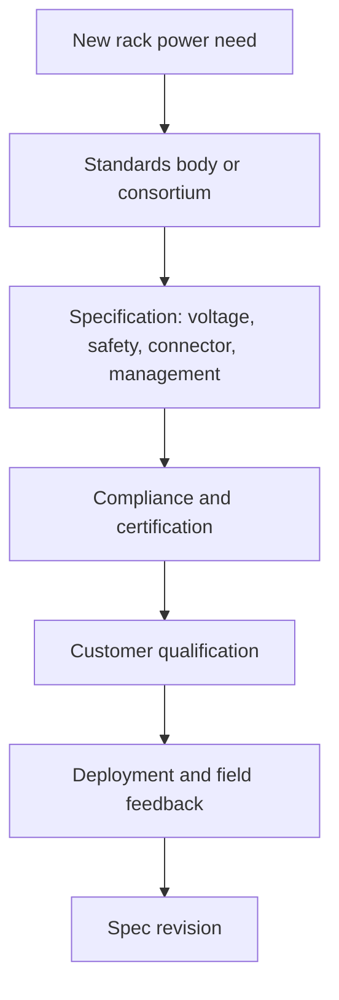
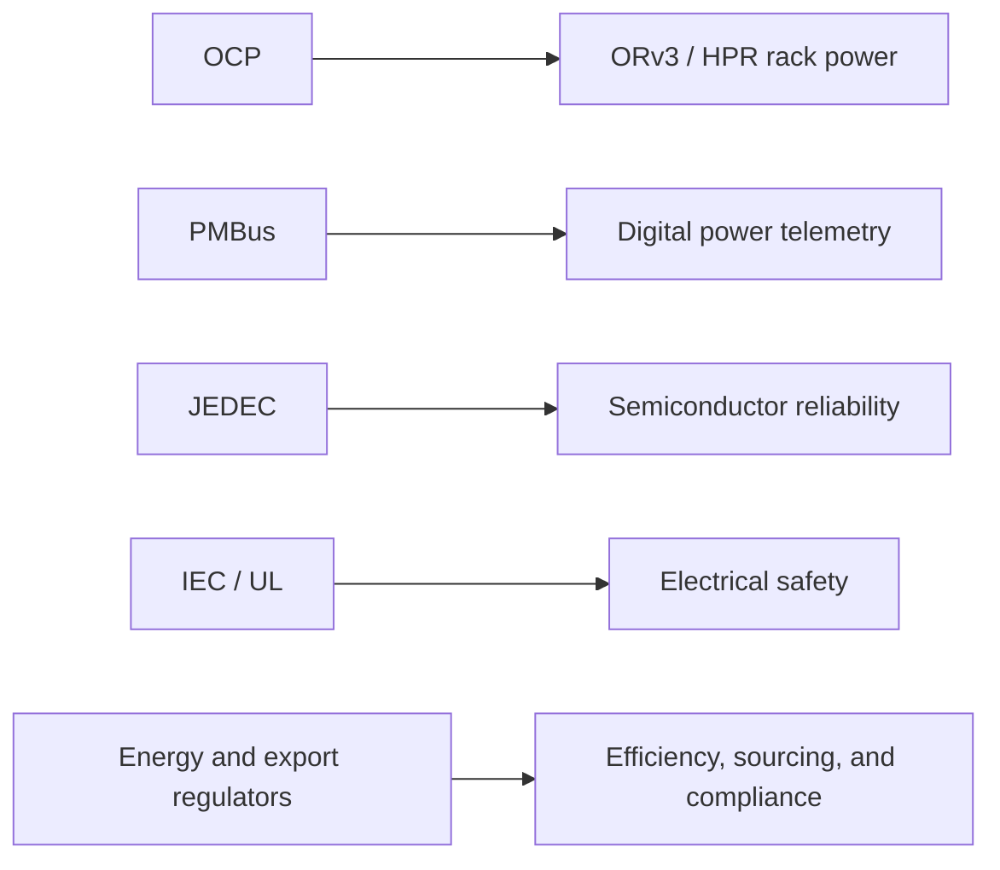

# Standards and Regulatory
> **Last Updated:** 2026-07-28
> **Status:** Draft
> **Tags:** standards, OCP, PMBus, IEC, IEEE, regulation

## Overview
Datacenter power products must satisfy electrical safety, EMC, grid-quality, efficiency,
environmental, and management-interface requirements. Standards apply at different boundaries:
component qualification, PSU, rack, server, facility, and utility interconnect.

Several seed labels require caution. Intel VR specifications may be platform-confidential,
ATX/PCIe connector rules do not universally govern rack-scale accelerators, and obsolete UL
60950 references have largely transitioned to hazard-based IEC/UL 62368-1.

## Key Findings / Highlights
- [CONFIRMED] ORv3 is an OCP rack/power specification centered on 48 V.
- [CONFIRMED] PMBus 1.4 defines digital power-management commands.
- [CONFIRMED] IEEE 519 addresses harmonic control at the point of common coupling.
- [CONFIRMED] IEC/UL 62368-1 replaces legacy 60950-1 for many ICT products.
- [CONFIRMED] JEDEC JEP173 addresses GaN dynamic on-resistance measurement, not full product qualification.
- [CONFIRMED, 2026] NVIDIA's 800 VDC publication is an architecture and partner roadmap,
  not an OCP/IEC/UL rack-power standard. Treat 2027 production timing separately from
  standards maturity.
- [CONFIRMED, 2026-07-28] OCP's Data Center Facility Power subproject lists its DC power
  white paper v1.0 as released in March 2026 and v1.1 as planned for July 2026; the project
  page does not yet confirm v1.1 release.

## Visual Guide

## Detailed Content
### Standards Tracker

| Standard | Body | Description | Boundary | Status/impact |
|---|---|---|---|---|
| ORv3 | OCP | 48 V rack, shelf, BBU | rack | Active |
| ATX 3.x / PCIe CEM | Intel/PCI-SIG | PC PSU/connectors | server/board | Limited rack-scale applicability |
| VR12/13/14 class | Intel/platform owners | Processor voltage regulation | board | Platform-specific |
| PMBus 1.4 | PMBus/SBS | Digital power commands | IC/system | Active |
| Redfish | DMTF | Management API/model | server/fleet | Active |
| IEEE 519-2022 | IEEE | Harmonic control | facility PCC | Active |
| IEC 61000 series | IEC | EMC/immunity/harmonics | product/facility | Active |
| JEDEC JEP173 | JEDEC | GaN dynamic RON test | device | Active |
| AEC-Q101 | AEC | Discrete qualification | device/auto | Proxy, not DC-specific |
| IEC/UL 62368-1 | IEC/UL | Hazard-based ICT safety | PSU/system | Active |
| 80 PLUS | CLEAResult | PSU efficiency certification | PSU | Active |
| OCP DCF Power Distribution white paper | OCP | Facility DC architecture workstreams | facility | v1.0 released 2026-03; v1.1 listed as planned 2026-07 |
| NVIDIA 800 VDC architecture | Vendor ecosystem | 800 VDC AI-factory/rack migration | facility/rack | Roadmap, not a consensus standard |

### United States

| Policy | Relevance | Status |
|---|---|---|
| DOE energy conservation rules | Certain power supplies/equipment | Product-class dependent |
| ENERGY STAR servers | Server efficiency/reporting | Program specifications |
| California Title 24 | Building/data center energy | Version/site dependent |
| CHIPS Act | Domestic semiconductor capacity | Awards/conditions evolve |
| BIS export controls | Semiconductor equipment/technology | Rapidly evolving |

### European Union

EED data-center reporting, Ecodesign/product rules, CE marking, RoHS, and REACH can affect
facility reporting and product materials. There is no single universal EU PUE cap applicable
identically to all datacenters; national implementation and delegated acts must be checked.

### China

GB standards, CCC where applicable, MIIT policy, and CEPREI testing influence market access and
localization. "Domestic substitution targets" should be cited to specific policy documents,
not repeated as a generalized percentage.

> 🔄 Refresh Needed: High Priority. Export controls, EU reporting rules, and China industrial
policy can change several times per year.

Related: [Master Index](README.md).

## Data Tables (where applicable)
| Field | Value | Source | Date |
|---|---|---|---|
| IEEE harmonic standard | IEEE 519-2022 | IEEE | 2022 |
| ICT safety standard | IEC/UL 62368-1 | IEC/UL | current |
| PMBus family | Revision 1.4 | PMBus | 2023+ |
| ORv3 bus | 48 V | OCP | 2024 |
| GaN dynamic RON guide | JEP173 | JEDEC | current |
| OCP DCF Power white paper | v1.0 released; v1.1 planned | OCP project page | 2026-07-28 status |

## Open Questions / Gaps
- Link exact clauses and editions applicable to each product boundary.
- Track BIS rules with effective dates, ECCNs, and affected equipment.
- Map EED reporting implementation by EU member state.
- Confirm current 80 PLUS datacenter PSU test protocols.

## References
- OCP specifications | https://www.opencompute.org/wiki/Open_Rack/SpecsAndDesigns | Accessed 2026-06-10
- PMBus | https://pmbus.org/ | Accessed 2026-06-10
- IEEE 519-2022 | https://standards.ieee.org/standard/519-2022.html | Accessed 2026-06-10
- IEC 62368-1 | https://webstore.iec.ch/en/publication/27412 | Accessed 2026-06-10
- US BIS | https://www.bis.gov/ | Accessed 2026-06-10
- OCP Data Center Facility Power | https://www.opencompute.org/wiki/Data_Center_Facility/Power | Accessed 2026-07-28
- NVIDIA 800 VDC architecture | https://www.nvidia.com/en-us/data-center/technologies/800-vdc-architecture/ | Accessed 2026-07-28
