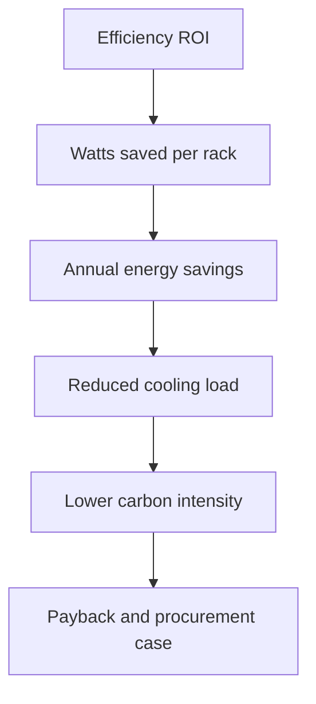

# Sustainability and Efficiency
> **Last Updated:** 2026-11-12
> **Status:** Draft
> **Tags:** PUE, efficiency, carbon, energy, WUE

## Overview
Conversion efficiency affects electricity cost, cooling load, capacity utilization, and carbon
emissions. PUE measures total facility energy divided by IT energy; it does not directly isolate
semiconductor efficiency and can improve or worsen with climate, utilization, and accounting.

WBG can reduce conversion loss, but embodied carbon, manufacturing yield, cooling, workload
utilization, and grid carbon intensity determine lifecycle impact. Architecture comparisons
must use the same load profile and system boundary.

## Key Findings / Highlights
- [CONFIRMED] A 1 percentage-point efficiency gain at 100 MW continuous load saves 8.76 GWh/year.
- [ESTIMATED] At $0.10/kWh, that energy is worth about $876k/year, not always exactly $1M.
- [CONFIRMED] Best hyperscaler PUE values approach ~1.1 annually at favorable sites; Google
  reported a 1.09 fleet-wide PUE for 2025 [Source: Google 2026 Environmental Report, 2026-06-30].
- [ESTIMATED] GaN totem-pole PFC can improve stage efficiency by roughly 0.5-1.5 points versus legacy silicon designs.
- [CONFIRMED] WUE complements PUE by tracking water use.
- [CONFIRMED, 2026-06] Google's 2025 electricity use rose 37%, its largest annual increase on
  record, while operational emissions fell 2% [Source: Google, 2026-06-30].
- [CONFIRMED, 2026-06] LBNL's 2025 update projects US datacenter electricity of 649 TWh in 2030
  in its reference case (range 521-843 TWh, about 9.5-15.3% of US electricity) [Source: LBNL/DOE].
- [CONFIRMED, 2026] The IEA estimates global datacenter demand of ~485 TWh in 2025, rising to
  ~950 TWh in 2030 [Source: IEA, Key Questions on Energy and AI].
- [ESTIMATED, VENDOR CLAIM, 2026-09] ABB claims DC distribution can raise end-to-end efficiency
  by more than 5% and forecasts 25-40% of new datacenter capacity using DC distribution by 2030.

## Visual Guide

## Detailed Content
### PUE Interpretation

| PUE | Classification | Semiconductor contribution | Enablers |
|---:|---|---|---|
| >2.0 | Legacy/inefficient | Small relative to cooling/facility | Modernize entire facility |
| 1.4-1.6 | Typical existing fleet range | Conversion gains visible | Better cooling/UPS |
| 1.1-1.2 | Leading hyperscale | Every loss point matters | efficient power + climate/cooling |
| 1.03-1.05 | Exceptional/theoretical-like | Boundary-sensitive | free cooling/direct power |

### Architecture Loss Model

| Architecture | AC/DC loss | DC/DC loss | VRM loss | Total | Annual loss cost at 1 MW, $0.10/kWh |
|---|---:|---:|---:|---:|---:|
| Traditional 12 V | 3% | 3% | 8% | ~13.5% compounded | ~$118k |
| 48 V ORv3 | 2.5% | 2.5% | 6% | ~10.6% | ~$93k |
| 400 V HVDC | 2% | 2% | 6% | ~9.7% | ~$85k |
| 800 V projected | 1.5% | 1.5% | 5% | ~7.8% | ~$68k |

> ⚠️ Note: Illustrative [ESTIMATED, LOW confidence] full-load model. Real annual cost requires
load curves, redundancy, cooling interaction, and architecture-specific measurements.

### WBG Uplift

| Change | Efficiency uplift | Confidence |
|---|---:|---|
| GaN totem-pole vs bridge PFC | 0.5-1.5 percentage points | MED |
| SiC/resonant vs legacy hard-switching | 0.3-0.8 points | LOW-MED |
| 48 V GaN bus/POL vs legacy path | 1-2 system points | LOW |

### Hyperscaler Commitments

| Company | Public target | Year | Power implication |
|---|---|---:|---|
| Google | 24/7 carbon-free energy | 2030 | Temporal workload/energy matching |
| Microsoft | Carbon negative | 2030 | Efficiency and clean-power procurement |
| Meta | Net-zero value chain | 2030 target framework | Efficient open infrastructure |
| Amazon | Net-zero carbon | 2040 | Renewable and efficiency investment |

### Energy Demand Benchmarks

| Scope | Metric | Value | Source | Date |
|---|---|---:|---|---|
| Google fleet | Annual PUE | 1.09 | Google Environmental Report | 2025 data |
| US datacenters | 2030 reference-case electricity | 649 TWh (range 521-843) | LBNL/DOE | 2025 update |
| Global datacenters | Electricity demand | ~485 TWh (2025) to ~950 TWh (2030) | IEA | 2026 publication |

### ROI Calculation

100 MW x 1% x 8,760 h = 8.76 GWh. At $0.10/kWh, annual gross energy savings are $876,000.
Avoided cooling energy and capacity may increase value; redundancy and partial-load behavior
may reduce it.

Related: [Master Index](README.md).

## Data Tables (where applicable)
| Field | Value | Source | Date |
|---|---|---|---|
| 1% of 100 MW | 1 MW | Calculation | 2026 |
| Annual energy | 8.76 GWh | Calculation | 2026 |
| Value at $0.10/kWh | $876,000/year | Calculation | 2026 |
| Google CFE target | 24/7 by 2030 | Google | current |
| Amazon net-zero target | 2040 | Amazon | current |
| Google 2025 fleet PUE | 1.09 | Google | 2026-06-30 |
| LBNL 2030 US DC reference | 649 TWh | LBNL | 2025 update |

## Open Questions / Gaps
- Replace illustrative loss model with measured partial-load efficiency curves.
- Add location-based and market-based carbon accounting.
- Quantify embodied carbon of Si, SiC, and GaN devices per delivered lifetime kWh.
- Track target changes and progress annually from sustainability reports.

## References
- The Green Grid PUE | https://www.thegreengrid.org/ | Accessed 2026-06-10
- Google 24/7 carbon-free energy | https://sustainability.google/operating-sustainably/energy/ | Accessed 2026-06-10
- Microsoft sustainability | https://www.microsoft.com/en-us/corporate-responsibility/sustainability | Accessed 2026-06-10
- Meta sustainability | https://sustainability.atmeta.com/ | Accessed 2026-06-10
- Amazon sustainability | https://sustainability.aboutamazon.com/ | Accessed 2026-06-10
- Google 2026 Environmental Report | https://sustainability.google/files/google-2026-environmental-report.pdf | Indexed 2026-11-12
- LBNL US Data Center Energy Usage Report 2025 | https://eta-publications.lbl.gov/publications/united-states-data-center-energy-2025 | Indexed 2026-11-12
- IEA Key Questions on Energy and AI | https://iea.blob.core.windows.net/assets/3179f7f8-01f6-4dd6-bffa-c9f7b73f1dc9/KeyQuestionsonEnergyandAI.pdf | Indexed 2026-11-12
- ABB Infinitus DC portfolio | https://www.globenewswire.com/news-release/2026/09/21/3365178/0/en/abb-s-new-direct-current-portfolio-aims-to-rewire-ai-data-center-energy-infrastructure.html | Indexed 2026-11-12
