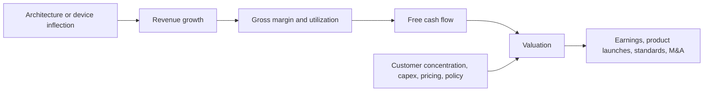
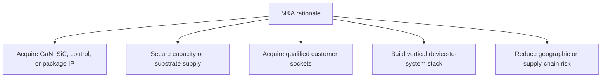

# Investment and M&A Tracker
> **Last Updated:** 2026-07-28
> **Status:** Draft
> **Tags:** investment, valuation, M&A, catalysts, financials

## Overview
The investment framework links AI rack growth to semiconductor content, technology mix,
supplier share, margins, and capital intensity. Public valuations change daily and company
financial periods differ, so this file provides schemas and dated deal facts rather than
undated point estimates.

Datacenter exposure is usually inferred. Automotive SiC revenue, consumer GaN adapters, and
general analog revenue must not be counted as datacenter revenue without product/customer
evidence.

## Key Findings / Highlights
- [CONFIRMED] M&A consolidated GaN Systems, Transphorm, GeneSiC, and UnitedSiC during 2021-2024.
- [CONFIRMED, 2025] Wolfspeed restructuring demonstrated the risk of capacity-led growth funded with debt.
- [ESTIMATED] Content per rack is a stronger AI-power driver than server-unit growth alone.
- [ESTIMATED] Hyperscaler custom controllers threaten some merchant IC content but can expand qualified power-stage demand.
- [CONFIRMED] Market cap, EV, short interest, and consensus require a same-day market-data refresh.
- [CONFIRMED, 2026] Infineon targets ~€1.5B FY2026 and ~€2.5B FY2027 AI-power revenue;
  onsemi disclosed >$250M FY2025 AI-datacenter revenue; MPS disclosed an 800 V solution in
  sampling. These are company-specific categories, not directly comparable market-share data.
- [CONFIRMED, 2026-07] WBG litigation is now an explicit investment risk: final
  Infineon/Innoscience US remedies contrast with the allegation-only Wolfspeed/Navitas filing.

## Visual Guide

## Detailed Content
> 🔄 Refresh Needed: High Priority. Populate market data only with an explicit as-of timestamp,
diluted share count, net debt definition, fiscal period, and currency.

### Public Company Tracker

| Company | Ticker | Market cap | EV | Revenue LTM | YoY | GM | EV/Rev | P/E | DC power rev | DC % | Consensus |
|---|---|---:|---:|---:|---:|---:|---:|---:|---:|---:|---|
| Infineon | IFX.DE | [REFRESH] | [REFRESH] | [FY/LTM REFRESH] | | | | | [EST.] | [EST.] | |
| TI | TXN | [REFRESH] | [REFRESH] | [FY/LTM REFRESH] | | | | | [EST.] | [EST.] | |
| Renesas | 6723.T | [REFRESH] | [REFRESH] | [FY/LTM REFRESH] | | | | | [EST.] | [EST.] | |
| MPS | MPWR | [REFRESH] | [REFRESH] | [FY/LTM REFRESH] | | | | | [EST.] | [EST.] | |
| Navitas | NVTS | [REFRESH] | [REFRESH] | [FY/LTM REFRESH] | | | | | [EST.] | [EST.] | |
| Vicor | VICR | [REFRESH] | [REFRESH] | [FY/LTM REFRESH] | | | | | [EST.] | [EST.] | |
| Vertiv | VRT | [REFRESH] | [REFRESH] | [FY/LTM REFRESH] | | | | | [EST.] | [EST.] | |

### Latest Reported Revenue Baselines

| Company | Period | Revenue | AI/datacenter disclosure |
|---|---|---:|---|
| Infineon | FY2025 | €14.662B | >€700M FY2025 AI power; ~€1.5B FY2026 and ~€2.5B FY2027 targets |
| TI | CY2025 | $17.682B | Not separately disclosed |
| Renesas | CY2025 | ¥1.321T IFRS | Not separately disclosed |
| MPS | CY2025 | $2.790B | $732.5M storage/computing; $701.8M enterprise data; categories not AI-pure |
| onsemi | CY2025 | $5.995B | >$250M AI-datacenter revenue |
| Microchip | FY2026 | $4.713B | Not separately disclosed |

### Valuation Benchmark

| Company | EV/Revenue | EV/EBITDA | P/E | EV/GP | Premium | Justification |
|---|---:|---:|---:|---:|---:|---|
| [Refresh set] | | | | | | Growth, margin, capital intensity, DC exposure |

### SiC Tracker

| Company | SiC revenue | Growth | % total | 200 mm capacity | Win/loss |
|---|---:|---:|---:|---|---|
| Wolfspeed | [REFRESH post-restructuring] | | high | Mohawk Valley/materials | Utilization key |
| ST/onsemi/Infineon/ROHM | [SEGMENT EST.] | | | [NORMALIZE] | Auto-to-DC crossover |

### GaN Tracker

| Company | GaN revenue | Growth | DC GaN % | Design wins |
|---|---:|---:|---:|---|
| Infineon | [NOT DISCLOSED] | | [EST.] | PSU/consumer/industrial |
| Navitas | [REFRESH filings] | | [EST.] | Company-announced pipeline |
| Renesas/Transphorm | [NOT DISCLOSED] | | [EST.] | HV GaN |
| EPC | Private | | [EST.] | Robotics/DC conversion |

### Recent Deals

| Date | Acquirer | Target | Value | Multiple | Rationale | DC impact |
|---|---|---|---:|---:|---|---|
| 2024 | Renesas | Transphorm | ~$339M equity | [TO CALC] | GaN | Adds HV GaN |
| 2023 | Infineon | GaN Systems | $830M | [TO CALC] | GaN scale | Consolidation |
| 2022 | Navitas | GeneSiC | ~$100M + earnouts [verify] | [TO CALC] | Add SiC | WBG breadth |
| 2021 | Qorvo | UnitedSiC | Undisclosed | n/a | Add SiC | Portfolio option |

### Venture Tracker

| Company | Stage | Amount | Date | Lead | Valuation | Notes |
|---|---|---:|---|---|---:|---|
| Cambridge GaN Devices | [REFRESH] | [REFRESH] | [REFRESH] | [REFRESH] | Private | See [14](14_startups_watchlist.md) |
| SemiQ | [REFRESH] | [REFRESH] | [REFRESH] | [REFRESH] | Private | SiC |
| Amperesand | Series A / private | >$100M total [COMPANY DISCLOSURE] | 2026 status | Walden Catalyst/Temasek among disclosed backers | Private | SiC SST; first commercial units targeted 2026 |
| Heron Power | Private | [REFRESH] | 2026 status | [REFRESH] | Private | 4.2 MW 800 VDC SST + SuperBBU vendor specification |

### Risk Flags

| Company/theme | Short interest | Bear thesis | Bull counter |
|---|---:|---|---|
| WBG specialists | [REFRESH] | ASP pressure/cash burn | AI/HVDC design wins |
| SiC capacity | n/a | Oversupply/utilization | New infrastructure demand |
| Merchant controllers | n/a | Custom silicon | Growing rail count/complexity |

### Catalyst Calendar

| Timing | Event | Catalyst | Bull case | Bear case |
|---|---|---|---|---|
| March | APEC / NVIDIA GTC | Topologies and rack power | New WBG designs | Slow qualification |
| May/June | PCIM Europe | Device/capacity launches | Cost/performance gains | Price pressure |
| October | OCP Global Summit | Rack standards | 48 V/HVDC adoption | Fragmentation |
| Quarterly | Earnings | DC revenue/margins | Content growth | Inventory/capex |
| 2026 H2 | onsemi vertical GaN target | 700/1,200 V production ramp | New 800 V conversion option | Qualification/yield delay |
| 2027+ | NVIDIA Kyber/800 VDC | MW-scale rack transition | Higher WBG/protection content | Standards/deployment delay |

## Data Tables (where applicable)
| Field | Value | Source | Date |
|---|---|---|---|
| Infineon/GaN Systems | $830M | Infineon | 2023 |
| Renesas/Transphorm | ~$339M equity value | Renesas | 2024 |
| Wolfspeed debt reduction | ~$4.6B announced | Wolfspeed | 2025 |
| Vertiv FY2024 revenue | ~$8.0B | Vertiv 10-K | FY2024 |
| Market-data refresh | Same-day required | Database convention | 2026 |

## Open Questions / Gaps
- Populate same-day market data and latest fiscal/LTM metrics.
- Reconcile enterprise value after leases, converts, pensions, and restructuring.
- Build audited DC revenue bridges by company.
- Add transaction revenue multiples from target filings.
- Add funding rounds from primary announcements and regulatory filings.

## References
- SEC EDGAR | https://www.sec.gov/edgar/search/ | Accessed 2026-06-10
- Company investor-relations sites | respective companies | Accessed 2026-06-10
- APEC | https://apec-conf.org/ | Accessed 2026-06-10
- OCP Global Summit | https://www.opencompute.org/summit/global-summit | Accessed 2026-06-10
- PCIM Europe | https://pcim.mesago.com/ | Accessed 2026-06-10
- Infineon FY2026 AGM CEO speech | https://www.infineon.com/assets/row/public/documents/corporate/investors/annual-general-meeting/2026/agm2026-key-points-speech-jochen-hanebeck-chief-executive-officer-v01-00-en.pdf | Accessed 2026-07-28
- onsemi 2025 annual report | https://investor.onsemi.com/static-files/8d674d4f-cc6b-44e5-8e31-e898ab0b4371 | Accessed 2026-07-28
- MPS FY2025 Form 10-K | https://media.monolithicpower.com/mps_cms_document/2/0/2025_form_10-k_final.pdf | Accessed 2026-07-28
- MPS Q4/FY2025 earnings commentary | https://www.monolithicpower.com/media/investor-relations/press-releases/Q4_2025_MPS_Earnings_Commentary.pdf | Accessed 2026-07-28
- Amperesand | https://www.amperesand.io/about | Accessed 2026-07-28
- Wolfspeed v. Navitas announcement | https://www.wolfspeed.com/company/news-events/news/wolfspeed-files-patent-infringement-lawsuit-against-navitas-semiconductor/ | Accessed 2026-07-28
