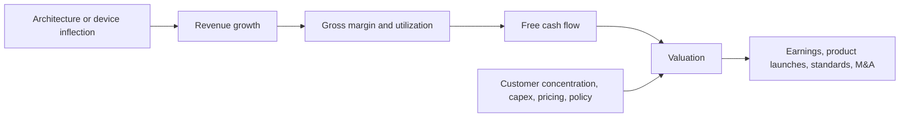
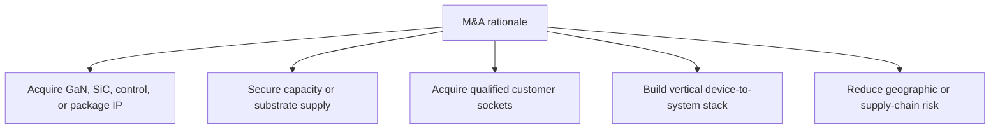

# Investment and M&A Tracker
> **Last Updated:** 2026-11-12
> **Status:** Draft
> **Tags:** investment, valuation, M&A, catalysts, financials

## Overview
The investment framework links AI rack growth to semiconductor content, technology mix,
supplier share, margins, and capital intensity. Public valuations change daily and company
financial periods differ, so this file provides schemas and dated deal facts rather than
undated point estimates.

Datacenter exposure is usually inferred. Automotive SiC revenue, consumer GaN adapters, and
general analog revenue must not be counted as datacenter revenue without product/customer
evidence.

## Key Findings / Highlights
- [CONFIRMED] M&A consolidated GaN Systems, Transphorm, GeneSiC, and UnitedSiC during 2021-2024.
- [CONFIRMED, 2025] Wolfspeed restructuring demonstrated the risk of capacity-led growth funded with debt.
- [ESTIMATED] Content per rack is a stronger AI-power driver than server-unit growth alone.
- [ESTIMATED] Hyperscaler custom controllers threaten some merchant IC content but can expand qualified power-stage demand.
- [CONFIRMED] Market cap, EV, short interest, and consensus require a same-day market-data refresh.
- [CONFIRMED, 2026] Infineon targets ~€1.5B FY2026 and ~€2.5B FY2027 AI-power revenue;
  onsemi disclosed >$250M FY2025 AI-datacenter revenue; MPS disclosed an 800 V solution in
  sampling. These are company-specific categories, not directly comparable market-share data.
  [SUPERSEDED 2026-11: Infineon reported ~€1.7B FY2026 AI power and ~€2.2B DC power, guiding
  FY2027 DC power close to €4B; onsemi expects ~$620M 2026 AI-DC revenue and >$3B by 2030.]
- [CONFIRMED, 2026] Processor-power M&A wave: ADI/Empower (~$1.5B, closed 2026-07-07),
  Navitas/Claros (up to ~$232.8M, closed 2026-10-06), Infineon/C2i (undisclosed, closed ~2026-10),
  and onsemi/Ferric ($600M + up to $175M, announced 2026-11-02). Infrastructure deals: Vertiv/UIG
  (~$1.45B + up to $1.15B earn-out, ~13x 2027E EBITDA per Vertiv), Eaton/COL (EV €810M), and
  Eaton/Boyd Thermal ($9.5B, closed 2026-03-12).
- [CONFIRMED, 2026-10] Vicor's royalty stream (~34% of Q3 2026 revenue) and ITC case 337-TA-1526
  create both upside (licensing) and supply-chain risk for named respondents.
- [CONFIRMED, 2026-10-07] Wolfspeed's conditional up-to-$1.5B OSC loan (with warrants up to 7.5%
  of fully diluted equity) is the key balance-sheet catalyst for the SiC specialist.
- [CONFIRMED, 2026-07] WBG litigation is now an explicit investment risk: final
  Infineon/Innoscience US remedies contrast with the allegation-only Wolfspeed/Navitas filing.

## Visual Guide

## Detailed Content
> 🔄 Refresh Needed: High Priority. Populate market data only with an explicit as-of timestamp,
diluted share count, net debt definition, fiscal period, and currency. Same-day market data was
not available in the 2026-11-12 refresh; the latest reported-period table below was updated instead.

### Public Company Tracker

| Company | Ticker | Market cap | EV | Revenue LTM | YoY | GM | EV/Rev | P/E | DC power rev | DC % | Consensus |
|---|---|---:|---:|---:|---:|---:|---:|---:|---:|---:|---|
| Infineon | IFX.DE | [REFRESH] | [REFRESH] | [FY/LTM REFRESH] | | | | | [EST.] | [EST.] | |
| TI | TXN | [REFRESH] | [REFRESH] | [FY/LTM REFRESH] | | | | | [EST.] | [EST.] | |
| Renesas | 6723.T | [REFRESH] | [REFRESH] | [FY/LTM REFRESH] | | | | | [EST.] | [EST.] | |
| MPS | MPWR | [REFRESH] | [REFRESH] | [FY/LTM REFRESH] | | | | | [EST.] | [EST.] | |
| Navitas | NVTS | [REFRESH] | [REFRESH] | [FY/LTM REFRESH] | | | | | [EST.] | [EST.] | |
| Vicor | VICR | [REFRESH] | [REFRESH] | [FY/LTM REFRESH] | | | | | [EST.] | [EST.] | |
| Vertiv | VRT | [REFRESH] | [REFRESH] | [FY/LTM REFRESH] | | | | | [EST.] | [EST.] | |

### Latest Reported Revenue Baselines

| Company | Period | Revenue | AI/datacenter disclosure |
|---|---|---:|---|
| Infineon | FY2025 | €14.662B | >€700M FY2025 AI power; ~€1.5B FY2026 and ~€2.5B FY2027 targets |
| TI | CY2025 | $17.682B | Not separately disclosed |
| Renesas | CY2025 | ¥1.321T IFRS | Not separately disclosed |
| MPS | CY2025 | $2.790B | $732.5M storage/computing; $701.8M enterprise data; categories not AI-pure |
| onsemi | CY2025 | $5.995B | >$250M AI-datacenter revenue |
| Microchip | FY2026 | $4.713B | Not separately disclosed |
| Infineon | FY2026 (to 2026-09-30) | €16.353B | ~€1.7B AI power; ~€2.2B DC power; FY2027 group ~€20B and DC power ~€4B guided |
| TI | Q3 2026 | $6.06B | Data center ~13% of revenue (+~95% YoY) |
| ADI | FQ3 FY2026 | $4.02B | DC ~80% of Communications |
| onsemi | Q3 2026 | ~$1.72B | $180M AI DC; ~$620M 2026E |
| MPS | Q3 2026 | $1,202.4M | $506.7M Enterprise Data |
| Vicor | Q3 2026 | $197.1M | Royalty $66.6M; backlog $406M |
| Vertiv | Q3 2026 | $4,313M | FY2026 guide $14.45-14.85B |
| Eaton | Q3 2026 | $8.9B | Electrical Americas backlog ~$16.0B |
| Navitas | Q3 2026 | $14.0M | AI infrastructure >40% of Q4 2026 guide |
| Wolfspeed | Q1 FY2027 | ~$155M | AI DC revenue >2x in FY2026 |

### Valuation Benchmark

| Company | EV/Revenue | EV/EBITDA | P/E | EV/GP | Premium | Justification |
|---|---:|---:|---:|---:|---:|---|
| [Refresh set] | | | | | | Growth, margin, capital intensity, DC exposure |

### SiC Tracker

| Company | SiC revenue | Growth | % total | 200 mm capacity | Win/loss |
|---|---:|---:|---:|---|---|
| Wolfspeed | $665.1M FY2026 (FY2025 $757.6M) | -12% | high | Mohawk Valley/materials | Utilization key; negative gross margin |
| ST/onsemi/Infineon/ROHM | [SEGMENT EST.] | | | [NORMALIZE] | Auto-to-DC crossover |
| ST Power & Discrete (incl. SiC) | $477M Q3 2026 | +11.3% | n/a | Catania/Chongqing 200 mm start-up | $81M operating loss |
| SICC (substrates) | ~RMB 914M H1 2026 | +15.1% | high | 8-inch >50% of Q3 revenue | Price pressure |

### GaN Tracker

| Company | GaN revenue | Growth | DC GaN % | Design wins |
|---|---:|---:|---:|---|
| Infineon | [NOT DISCLOSED] | | [EST.] | PSU/consumer/industrial |
| Navitas | $14.0M Q3 2026 (Q4 guide $15.5-16.5M) | +39% YoY | >40% of Q4 guide (AI infrastructure) | NVIDIA 800 V boards; Microchip reference design |
| Innoscience | ~RMB 834M H1 2026 | +50.6% | Within ~RMB 532M combined AI DC/industrial/ESS/EV | #1 power GaN 2025 (Yole) |
| Renesas/Transphorm | [NOT DISCLOSED] | | [EST.] | HV GaN |
| EPC | Private | | [EST.] | Robotics/DC conversion |

### Recent Deals

| Date | Acquirer | Target | Value | Multiple | Rationale | DC impact |
|---|---|---|---:|---:|---|---|
| 2026-11-02 | onsemi | Ferric | $600M + up to $175M | n/a | IVR/magnetics | Processor-level power (pending) |
| 2026-10-27 | Vertiv | UtilityInnovation Group | ~$1.45B + up to $1.15B earn-out | ~13x 2027E EBITDA [company] | On-site power | Time-to-power |
| 2026-10-06 | Navitas | Claros | Up to ~$232.8M | n/a | IVR/vertical delivery | Grid-to-XPU portfolio |
| ~2026-10 | Infineon | C2i Semiconductors | Undisclosed | n/a | Multiphase control/stages | AI VR control |
| 2026-09-24 | Eaton | COL Group | EV €810M | ~3.2x 2027E sales [derived] | MV switchgear | Facility power (close Q1 2027) |
| 2026-07-07 | ADI | Empower Semiconductor | ~$1.5B cash | n/a | IVR/silicon capacitors | Processor-level power |
| 2026-03-12 | Eaton | Boyd Thermal | $9.5B | [TO CALC] | Liquid cooling | Thermal/power co-design |
| 2024 | Renesas | Transphorm | ~$339M equity | [TO CALC] | GaN | Adds HV GaN |
| 2023 | Infineon | GaN Systems | $830M | [TO CALC] | GaN scale | Consolidation |
| 2022 | Navitas | GeneSiC | ~$100M + earnouts [verify] | [TO CALC] | Add SiC | WBG breadth |
| 2021 | Qorvo | UnitedSiC | Undisclosed | n/a | Add SiC | Portfolio option |

### Venture Tracker

| Company | Stage | Amount | Date | Lead | Valuation | Notes |
|---|---|---:|---|---|---:|---|
| Cambridge GaN Devices | Series C | $32M | 2025-02-18 | British Patient Capital | Private | See [14](14_startups_watchlist.md) |
| SemiQ | Private | No 2026 round found | 2026 status | n/a | Private | SiC |
| Amperesand | Series A / private | >$100M total [COMPANY DISCLOSURE] | 2026 status | Walden Catalyst/Temasek among disclosed backers | Private | SiC SST; first commercial units targeted 2026 |
| Heron Power | Series B | $140M | 2026-02-18 | a16z American Dynamism; Breakthrough Energy Ventures | Private | 4.2 MW 800 VDC SST + SuperBBU vendor specification |
| DG Matrix | Series A | $60M | 2026-02-18 | Engine Ventures | Private | Interport multi-port SST |
| Vertical Semiconductor | Seed + CHIPS R&D LOI | $11M seed; up to $73M LOI | 2025-10 / 2026-10 | Playground Global; US Commerce | Private | Vertical GaN |

### Risk Flags

| Company/theme | Short interest | Bear thesis | Bull counter |
|---|---:|---|---|
| WBG specialists | [REFRESH] | ASP pressure/cash burn | AI/HVDC design wins |
| SiC capacity | n/a | Oversupply/utilization | New infrastructure demand |
| Merchant controllers | n/a | Custom silicon | Growing rail count/complexity |
| VPD module supply chain | n/a | ITC 337-TA-1526 exclusion risk | Licensing settlements |
| Navitas | [REFRESH] | Litigation on three fronts; small revenue | AI mix shift; $531.5M cash, no debt |
| Wolfspeed | [REFRESH] | Negative gross margin; utilization | OSC loan; AI DC revenue growth |

### Catalyst Calendar

| Timing | Event | Catalyst | Bull case | Bear case |
|---|---|---|---|---|
| March | APEC / NVIDIA GTC | Topologies and rack power | New WBG designs | Slow qualification |
| May/June | PCIM Europe | Device/capacity launches | Cost/performance gains | Price pressure |
| October | OCP Global Summit | Rack standards | 48 V/HVDC adoption | Fragmentation |
| Quarterly | Earnings | DC revenue/margins | Content growth | Inventory/capex |
| 2026 H2 | onsemi vertical GaN target | 700/1,200 V production ramp | New 800 V conversion option | Qualification/yield delay [no production confirmed by 2026-11-12] |
| 2026-11-24 | ADI FQ4 FY2026 results | Power/data-center commentary | Empower integration | Comms cyclicality |
| 2026-11-27 | China Ga/Ge US-ban suspension expiry | Gallium supply policy | Extension | Reinstated ban |
| 2026-12-12 to 16 | IEDM 2026 | Power/analog device papers | Vertical GaN/SiC advances | Research-only |
| End-2026 | onsemi/Ferric close | IVR integration | Processor-power share | Regulatory delay |
| Q1 2027 | Eaton/COL close | MV switchgear capacity | Facility power share | Integration |
| Q2 2027 | Vicor Fab-2 first equipment | Module capacity | Royalty + product growth | Execution |
| 2027-07-31 | TSMC GaN foundry exit | Fabless GaN transfers | Second sources ready | Supply gaps |
| 2H 2027 | ABB SST commercial availability; Rubin Ultra 800 V power racks | MV SST and 800 VDC ramp | Higher SiC/GaN/protection content | Slips to 2028 |
| 2027+ | NVIDIA Kyber/800 VDC | MW-scale rack transition | Higher WBG/protection content | Standards/deployment delay |
| 2027+ | 337-TA-1526 determination | VPD exclusion/licensing | Vicor royalties | Respondent design-arounds |

## Data Tables (where applicable)
| Field | Value | Source | Date |
|---|---|---|---|
| Infineon/GaN Systems | $830M | Infineon | 2023 |
| Renesas/Transphorm | ~$339M equity value | Renesas | 2024 |
| Wolfspeed debt reduction | ~$4.6B announced | Wolfspeed | 2025 |
| Vertiv FY2024 revenue | ~$8.0B | Vertiv 10-K | FY2024 |
| Vertiv FY2026 sales guidance | $14.45-14.85B | Vertiv | 2026-10-28 |
| ADI/Empower | ~$1.5B | ADI | 2026-07-07 |
| onsemi/Ferric | Up to $775M | onsemi | 2026-11-02 |
| Wolfspeed OSC financing | Up to $1.5B, conditional | Wolfspeed | 2026-10-07 |
| Market-data refresh | Same-day required | Database convention | 2026 |

## Open Questions / Gaps
- Populate same-day market data and latest fiscal/LTM metrics.
- Reconcile enterprise value after leases, converts, pensions, and restructuring.
- Build audited DC revenue bridges by company.
- Add transaction revenue multiples from target filings.
- Add funding rounds from primary announcements and regulatory filings.
- Verify the onsemi/Synaptics terms change (excluded here as non-datacenter-power).

## References
- SEC EDGAR | https://www.sec.gov/edgar/search/ | Accessed 2026-06-10
- Company investor-relations sites | respective companies | Accessed 2026-06-10
- APEC | https://apec-conf.org/ | Accessed 2026-06-10
- OCP Global Summit | https://www.opencompute.org/summit/global-summit | Accessed 2026-06-10
- PCIM Europe | https://pcim.mesago.com/ | Accessed 2026-06-10
- Infineon FY2026 AGM CEO speech | https://www.infineon.com/assets/row/public/documents/corporate/investors/annual-general-meeting/2026/agm2026-key-points-speech-jochen-hanebeck-chief-executive-officer-v01-00-en.pdf | Accessed 2026-07-28
- onsemi 2025 annual report | https://investor.onsemi.com/static-files/8d674d4f-cc6b-44e5-8e31-e898ab0b4371 | Accessed 2026-07-28
- MPS FY2025 Form 10-K | https://media.monolithicpower.com/mps_cms_document/2/0/2025_form_10-k_final.pdf | Accessed 2026-07-28
- MPS Q4/FY2025 earnings commentary | https://www.monolithicpower.com/media/investor-relations/press-releases/Q4_2025_MPS_Earnings_Commentary.pdf | Accessed 2026-07-28
- Amperesand | https://www.amperesand.io/about | Accessed 2026-07-28
- Wolfspeed v. Navitas announcement | https://www.wolfspeed.com/company/news-events/news/wolfspeed-files-patent-infringement-lawsuit-against-navitas-semiconductor/ | Accessed 2026-07-28
- Infineon FY2026 results (syndicated) | https://news.europawire.eu/infineon-reports-e16-35-billion-fy-2026-revenue-and-forecasts-over-20-percent-growth-for-2027/eu-press-release/2026/11/10/16/27/06/187084/ | Indexed 2026-11-12
- onsemi to acquire Ferric | https://investor.onsemi.com/news-releases/news-release-details/onsemi-acquire-ferric-establishing-leadership-power-delivery | Indexed 2026-11-12
- ADI completes Empower acquisition | https://www.analog.com/en/newsroom/press-releases/2026/7-7-26-adi-completes-acquisition-of-empower-semiconductor.html | Indexed 2026-11-12
- Navitas closes Claros | https://www.globenewswire.com/news-release/2026/10/06/3376021/0/en/navitas-closes-acquisition-of-claros-advancing-ai-infrastructure-with-grid-to-xpu-power-delivery.html | Indexed 2026-11-12
- Infineon/C2i acquisition | https://evertiq.com/design/2026-08-24-infineon-acquires-bangalore-based-c2i-semiconductors | Indexed 2026-11-12
- Vertiv/UIG announcement | https://www.vertiv.com/en-us/about/news-and-events/corporate-news/2026/vertiv-announces-agreement-to-acquire-utilityinnovation-group-to-accelerate-time-to-power-for-ai-data-centers/ | Indexed 2026-11-12
- Eaton/COL Group | https://secure.businesswire.com/news/home/20260924188286/es | Indexed 2026-11-12
- Eaton/Boyd Thermal completion | https://www.businesswire.com/news/home/20260312582488/en | Indexed 2026-11-12
- Vicor Q3 2026 results | https://www.sec.gov/Archives/edgar/data/0000751978/000119312526425697/d153882dex991.htm | Indexed 2026-11-12
- Vertiv Q3 2026 results | https://investors.vertiv.com/news/news-details/2026/Vertiv-Reports-Strong-Third-Quarter-2026-with-Net-Sales-Growth-of-61-Organic-Orders-Growth-over-100-and-Diluted-EPS-Growth-of-91-Adjusted-Diluted-EPS-Growth-of-78-Raises-Full-Year-2026-Guidance-Across-All-Key-Metrics/ | Indexed 2026-11-12
- Navitas Q3 2026 results | https://www.sec.gov/Archives/edgar/data/0001821769/000162828026069489/exhibit991-navitassemicond.htm | Indexed 2026-11-12
- Wolfspeed Q1 FY2027 results | https://www.sec.gov/Archives/edgar/data/0000895419/000089541926000075/ex991q1-27.htm | Indexed 2026-11-12
- Heron Power Series B | https://techcrunch.com/2026/02/18/heron-power-raises-140m-to-ramp-production-of-grid-altering-tech/ | Indexed 2026-11-12
- ADI FQ4 FY2026 results date | https://www.analog.com/en/newsroom/press-releases/2026/10-22-2026-adi-report-4q-fy2026-financial-results.html | Indexed 2026-11-12
